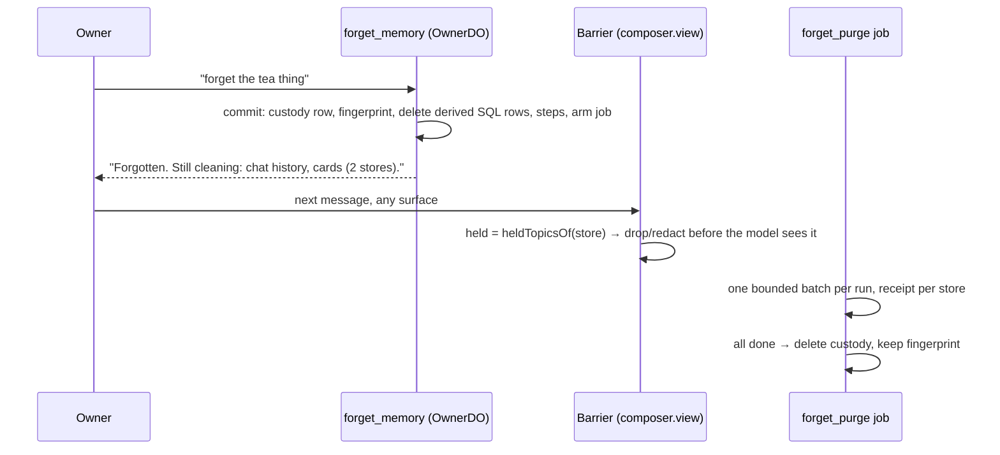

# Forget redesign: one barrier, hard deletion, a purge that gates nothing (22 October 2026)

Status: **proposed design**, owner-approved in principle on 22 Oct 09:35Z (PR #1400 rulings: the redesign, plurals and compound words surviving, the ADR amendments, dropping `memory_blocks`/`memory_inbox` after a hosted empty check). This document is the contract the build PRs are reviewed against. ADR drafts are in [`ADR_DRAFT_FORGET_BARRIER_2026-10-22.md`](ADR_DRAFT_FORGET_BARRIER_2026-10-22.md).

Source pin: `origin/beta-mvp` `8eae5128`. #1402 (word-boundary matching) is open and not on the pin; this design builds on its `literalTextPattern` and does not add a second matching rule. Labels: **[verified]** read in source at the pin; **[inference]** a conclusion; **[proposed]** this design.

## 1. The problem

The owner's guarantee is: once I say forget, Waldo never shows me or the model that thing again, and nothing it learned from it survives. Today the mechanism behind that guarantee is "every store must be proven clean before anything may read", and it fails in three ways.

1. **A held topic withholds whole reads.** While any topic is pending, `owner-turn.ts` filters the model's view at 24 sites. Seven of them drop a whole read rather than the matching item [verified]:
   - `withholdHeldItems` returns `undefined` for a held string or key outside a list, and the dispatcher turns that into a `transient` "withheld" (`owner-turn.ts:349-357`, `:473-474`);
   - the earlier-tool-results block is dropped whole if any line holds a topic (`:607-610`);
   - external workspace receipts and the guarded task context are dropped whole (`:617-618`);
   - an in-loop tool output that cannot be narrowed is replaced by `HELD_TURN_OUTPUT` (`:653`, `conversation/held-turns.ts:9-14`), so a public web page that mentions the topic once disappears;
   - the console memory graph empties claims, nodes and edges while any purge is pending (`channels/memory-graph.ts:10-38`), and the dashboard profile shows no sections (`channels/dashboard-controls.ts:79-83`).

   That is #1286: half the product goes missing for as long as one store will not verify.
2. **The purge is retried inside every owner turn.** `restored()` runs at the start of `respond`, `remind` and `prompt` (`owner-turn.ts:718-742`, `:876`, `:899`, `:914`) and re-redacts every store. With substring matching that rewrote "team" to "[forgotten]m" on every turn (#1395). The retry owner is the owner's chat, and a slow store makes every reply slower.
3. **Coverage is four hook lists, not one.** The forget tool, the per-turn retry, the console `spot.forget` and the console `node.forget` each call a different set of store redactors [verified, owner-do.ts:3255-3277, :3297, :4088-4111, :4113-4134]. `node.forget` runs no SQL purge at all; only the tool path reaches iMessage; edges and standing orders are outside the purge's redaction (`memory/claims.ts:509-513`, `:107`). Derived memory (claims that survive selection, nodes, update cards, backups) is redacted in place rather than deleted, so a paraphrase of the forgotten thing survives in Waldo's own words.

**Root cause, one sentence:** the privacy boundary sits on the stores instead of on the model's view, because there is no single seam every model-bound fragment crosses.

## 2. What changes

Three parts, each replacing something that exists.

| Part | Replaces | Guarantee it carries |
| --- | --- | --- |
| **Barrier** `applyForgetBarrier`, once, at the ContextComposer seam | the 24 filter sites in `owner-turn.ts`, `HELD_TURN_OUTPUT`, the graph and profile blanking | The model and the owner never see a held topic, from the moment of the forget, whatever the purge has done. |
| **Hard deletion of derived memory** | in-place redaction of claims, nodes, cards, backups and indexes | Nothing Waldo derived from the forgotten thing survives, paraphrases included, because the derived row is gone. |
| **Asynchronous purge job** | the in-transaction purge, the per-turn `restored()` retry, the nightly `migrate` throw | Every store is eventually cleaned, with a receipt per store, and nothing waits on it. |

What stays [verified, kept on purpose]:
- the owner names what to forget: the literal-substring check on the current owner message (`tools/live/memory.ts:95`);
- the hashed re-admission barrier (`forget_barriers`, content-free);
- `topic_purge_pending` written before anything is destroyed (custody before destruction, `claims.ts:564-572`);
- the owner's transcript is the one store redacted in place, by word, because it is the owner's own record;
- honest receipts naming every store still pending and every store outside reach.

## 3. The barrier contract

### 3.1 Matching

One rule: #1402's `literalTextPattern(topic)` from `@waldo/contracts` and the `carriesTopic`/`hidesTopic` predicates built on it. As the owner ruled and #1402 implements, a word boundary applies only between Latin, Greek or Cyrillic letters; CJK, kana, Hangul, Thai, Indic scripts and digits match as before; plurals and compound words survive ("tea" leaves "teapot" and "teas"). The barrier imports the rule and never re-derives it, so the barrier, the redactors and the purge readback cannot disagree. When #1402 merges, the build PRs rebase onto it.

Held topics are `heldTopicsOf(store)` (#1402: claims in `purging` plus `pendingTopics()`) plus the topics this turn's `forget_memory` calls removed. Patterns compile once per model call per held set.

### 3.2 Interface

```ts
// packages/runtime/src/context-composer/forget-barrier.ts [proposed]
export type ViewOrigin =
  | 'code'          // text this repository wrote (behaviour, skills, tool schemas, clock): never filtered
  | 'owner_record'  // the owner's own transcript rows, standing orders, open loops
  | 'owner_store'   // memory Waldo keeps about the owner: claims, nodes, edges, pinned blocks, recall, episode hits, ledger fragments
  | 'external';     // text from outside the owner: web pages, mail bodies, MCP results, workspace receipts, external tool outputs

export type ViewFragment = Readonly<{
  key: string;                       // stable id for the receipt (e.g. 'history:12', 'claim:7', 'tool:call_3')
  origin: ViewOrigin;
  text: string;                      // what the model would see
  items?: readonly ViewFragment[];   // a list read: the barrier drops matching items, never the list
}>;

export type BarrierResult = Readonly<{
  fragments: readonly ViewFragment[]; // same order, matching items dropped, external text redacted
  dropped: number;                    // owner items removed
  redacted: number;                   // external literals replaced
  notes: readonly string[];           // one typed note per affected fragment, rendered beside it
}>;

export const applyForgetBarrier = (fragments: readonly ViewFragment[], held: readonly string[]): BarrierResult;
```

With `held` empty it returns its input unchanged (same object), so a turn with nothing held costs one length check and the prompt bytes do not move.

### 3.3 Origin rules

| Origin | What the barrier does | Note the model sees |
| --- | --- | --- |
| `code` | Nothing. Code-authored instructions cannot carry an owner topic; filtering them would let a forget of "team" break the behaviour prompt. | none |
| `owner_store` | Drops each item that carries or hides a held topic. Never drops the list, the read or the section. A node built on a dropped claim is dropped, and so is every edge touching a dropped node (the rule `promptNodes` has today, kept). | `[waldo: N items about something the owner asked to forget are not shown; the rest is complete.]` |
| `owner_record` | Drops the matching item (a history message, an order line, a loop line). The owner's **current** message is never touched: it is the message that may be asking to forget. | as above |
| `external` | Replaces each literal with the marker by `literalTextPattern`, keeps the rest of the text. If the text still `hidesTopic` after redaction (the topic spelled by escapes), it parses as JSON when it can and redacts the decoded leaves; if it still hides, that one fragment is replaced by the note. That is the only whole-fragment drop, and it is bounded to text the matcher cannot read. | `[waldo: some words the owner asked to forget were removed from this text; the rest is unchanged.]` |

In-loop tool turns take their origin from the tool: `read_memory`, `read_owner_context`, `search_episodes`, `read_tool_output` are `owner_store` with their result lists as `items`; every tool in `EXTERNAL_ORIGIN_TOOLS` and every MCP result is `external`. A `forget_memory` turn is never filtered (as today). `HELD_TURN_OUTPUT` and `narrowHeldJson` are deleted.

Retained reads no longer return `transient` "withheld". A dropped item still sets `complete: false` and `withheld_items` on the read, so a filtered list never reads as complete (kept from `owner-turn.ts:477`).

### 3.4 Where it runs: the composer owns the whole view

Today the composer supplies only `instructions` and `operations`; history, the message suffix, recall, earlier tool results, pinned memory, loops, orders and tool turns are assembled in `owner-turn.ts` around it [verified, composer.ts:42-111; owner-turn.ts:548-653]. The barrier is only one seam if every model-bound fragment crosses one function, so the design moves the assembly behind the composer:

1. `owner-turn.ts`'s `step` builds a `ModelView` of typed fragments: system sections (`code` except pinned memory, orders and loops), history entries, the suffix parts (recall, earlier results, workspace receipts), the current message, and the tool turns.
2. `composer.view(modelView, held)` [proposed] applies `applyForgetBarrier` once and renders the provider request (`system`, `sections`, `messages`, `turns`).
3. `complete(...)` receives only the rendered view. A guard test asserts `owner-turn.ts` calls `complete` with nothing that did not come from `composer.view`.

Mapping of today's sites to fragments [verified sites, proposed mapping]:

| Today (`owner-turn.ts`) | Fragment |
| --- | --- |
| `:192-197` ledger fragments, earlier owner results | `owner_store` items; external-origin results inside them are `external` |
| `:232` `memoryContext.recent` | stays a tool context input, filtered by the same function (it feeds `forget_memory` span resolution, not the model) |
| `:349-357`, `:473-477` `withholdHeldItems` | `owner_store` items in tool turns |
| `:363-379` `promptNodes`, `promptMemory` | `owner_store` items: claims, nodes, edges, recall |
| `:392` `recallFor` holds | `owner_store` items: recall claims, previous owner message, episode hits |
| `:445-470` episode and alias re-reads | kept: the barrier judges an episode hit by its stored source row and a claim by its aliases, so these re-reads become the item text supplied to the barrier |
| `:548` history | `owner_record` items |
| `:553-558` orders, loops | `owner_record` items (one per line) |
| `:583` frozen-suffix reuse | the reuse key gains the held-set fingerprint; the text test goes |
| `:602`, `:607-618` recall, earlier results, receipts, task context | `owner_store` / `external` fragments; no whole-block drop |
| `:630-631` pinned memory, loops in the system prompt | `owner_store` / `owner_record` items |
| `:653` in-loop tool turns | per-tool origin, §3.3 |
| `:923-936`, `:947`, `:966` background decision, nightly consolidate, promote | the same `applyForgetBarrier` over their inputs (they build model input outside a turn) |
| `:957` `migrate` throws while held | removed; migration reads through the barrier |

Outside `owner-turn.ts`: `read_memory`'s `hidden(claim)` (`tools/live/memory.ts:46, :85`) and the console graph and profile (`memory-graph.ts`, `dashboard-controls.ts`, `owner-do.ts:1825`) use the same function with origin `owner_store`, so the console shows everything except the held items instead of nothing.

### 3.5 Prompt cache

A held topic changes the bytes of the fragments it touches and nothing else, so the stable head stays cached and the tail changes once per forget [inference]. A turn with nothing held is byte-identical to today's. The frozen suffix keys on `(steering, forgetEpoch, forgetGeneration, held fingerprint)` instead of re-testing its text.

## 4. Hard deletion of derived memory

Rule: a row Waldo derived is deleted (or regenerated from redacted inputs), never redacted in place. A redacted derived row keeps the paraphrase around the marker; a deleted one cannot. The owner's own records are redacted in place by word; effect custody rows keep their journal shape.

Store inventory [verified at the pin unless marked]:

| Store (location) | Class | Today | Redesign |
| --- | --- | --- | --- |
| `claims` carrying the topic (DO SQLite) | derived | selected ones deleted on settle; others redacted (`claims.ts:641-646`) | **delete** every claim that carries or hides it, at commit |
| `claim_recall` FTS5, pinned blocks, aliases | derived | follow the claim row | follow the delete (triggers, columns) |
| `constellation_nodes` | derived | label and summary redacted (`:764-769`) | **delete** a node that carries it or rests on a deleted claim |
| `constellation_edges` | derived | not redacted by purge; deleted only by `forgetNode` (`:509-513`) | **delete** every edge touching a deleted node or carrying it |
| `supporting_spots` refs | derived | ids stripped (`:771-777`) | follows node deletion |
| `episodes` (FTS index of the transcript) | derived index | redacted (`:616-621`) | **regenerate** each affected row from its redacted transcript entry |
| `memory_backups` | derived snapshot | redacted (`:622-627`) | **delete** the snapshots that carry it |
| `spots`, `core_file_revisions` (legacy) | derived | redacted (`:628-639`) | **delete** matching rows |
| `update_cards` | derived | leaves blanked (`:519-546`) | **delete** the card |
| `thread_topic_index`, `patrol_log`, `goals`, `background_runs.summary`, `day_plan.reason`, `run_candidates`, `held_candidates` | derived | redacted | **delete** matching rows (goals and day plan regenerate on the next planning pass) |
| `memory_blocks`, `memory_inbox` | dead schema | redacted | tables **dropped** after the hosted empty check (owner yes); until then, delete matching rows |
| tool-output ledger `toolout:` (KV) | derived | redacted (`tool-output-ledger.ts:233-254`) | **delete** matching fragments |
| compaction rows (KV) | derived summary | superseded to the marker and omitted | unchanged: `omit` plus regeneration from redacted rows |
| final outbox cards, mail follow-ups, calendar prep, job reports (KV) | derived cards | redacted; pending blocked; uncertain quarantined (`telegram-final-outbox.ts:455-510`) | unsent: **delete**; sent: redact (a sent card is a record of what the owner received) |
| WhatsApp held cards | derived | deleted (`whatsapp-window.ts:203-213`) | unchanged |
| waiting approval cards (`ledger`) | derived | status `skipped`; `summary` and `payload_json` not rewritten (`approvals.ts:273-283`) | `skipped` plus `summary` and `payload_json` **cleared**; the frozen digest stays so dispatch still refuses |
| `outbox.payload` | effect custody | replaced by a token, journal FAILED (`:727-739`) | unchanged (deleting breaks reconciliation) |
| `schedule.payload_json` | derived | one-shot deleted, others redacted (`:752-763`) | unchanged |
| app thread titles | derived | redacted (`app-threads.ts:79-92`) | **regenerate** from the redacted thread, or redact when regeneration fails |
| transcript `conv:` and canonical entries (KV) | owner record | redacted (`conversation-store.ts:179-225`) | unchanged: **redact by word in place** |
| `reminder_notes`, `standing_orders`, `loops.title` | owner record | reminders and loops redacted, open loops dropped; standing orders have no redactor | **redact by word** in all three; open loops dropped as today; the receipt names each, because a reminder still fires |
| iMessage owner inbox and outbox (owner DO) | owner record + derived | redacted (`imessage/forget.ts:11-26`) | unchanged; the bridge DO's own copies become a named residue in the receipt until the bridge exposes a forget call |
| `forget_barriers` | tombstone | fingerprint and marker only | unchanged |
| `topic_purge_pending` | custody | raw topic until settle | unchanged; deleted at settle |

Outside the DO, named in every receipt as residue (ADR-0055 amendment): Langfuse traces on staging (text capture is on there by owner ruling), provider request logs, the R2 archive, and the 30-day Durable Object point-in-time restore window.

## 5. The asynchronous purge

### 5.1 Commit (synchronous, inside the forget tool's transaction)

1. write `topic_purge_pending` (raw topic, custody first);
2. write the content-free barrier fingerprint;
3. delete the selected claims and everything §4 deletes from SQL in the same transaction (claims, FTS, nodes, edges, cards, backups, candidates) — cheap, local, no I/O;
4. insert one `forget_purge_steps` row per remaining store (below);
5. arm the job.

The tool answers when the commit lands: the barrier already holds, so from the owner's next word the thing is gone from the model's view. The receipt says which stores are still being cleaned. No KV redaction runs in the tool, so a slow store never fails the forget.

### 5.2 The job

- **Key:** `forget:<fingerprint>`; the fingerprint is the existing content-free barrier hash. The schedule row carries only the fingerprint (`payloadRefs: { fingerprint }`), never the topic, so the purge cannot itself leave the topic in `schedule.payload_json`.
- **Lane:** a scheduler kind `forget_purge` on the alarm lane now (additive `ScheduleKind` value); a `task_jobs` reader job after #1355 lands, with the brain applying the result.
- **Steps table** [proposed DO schema, additive]:

  ```sql
  CREATE TABLE forget_purge_steps (
    fingerprint TEXT NOT NULL, store TEXT NOT NULL,
    state TEXT NOT NULL CHECK (state IN ('pending', 'done', 'residue')),
    attempts INTEGER NOT NULL DEFAULT 0, last_code TEXT, cursor TEXT, updated_at INTEGER NOT NULL,
    PRIMARY KEY (fingerprint, store));
  ```

  `last_code` is an enum code, never error text (the error can quote the topic). `cursor` lets a store be cleaned in bounded batches.
- **One retry owner:** the job. Each run takes the oldest pending step, does at most one bounded batch (500 rows or one KV page), records `done` or keeps `pending` with `attempts + 1`, and re-arms with the scheduler's back-off. `restored()` per owner turn is deleted, and so is the nightly `applyClaimOps` purge of pending topics (`claims.ts:1236-1241`).
- **Idempotent:** every step re-reads before writing and is a no-op on clean data; a crash mid-batch resumes from `cursor`.
- **Settle:** when every step is `done` or `residue`, the job deletes `topic_purge_pending` and the steps, keeps the barrier, and writes one content-free `forget_settled` trace hop.
- **Stuck:** a step past the scheduler's quarantine (`QUARANTINE_AFTER_ATTEMPTS`) stays `pending`, the console shows it with a retry, and the barrier keeps the model's view clean. There is no TTL on the hold (owner ruling); a held topic now costs a few words, not pages.
- **Nothing waits on it:** the nightly pass, compaction, promotion and migration read through the barrier and never defer.

The single store registry (`FORGET_STORES`) lists every store with its class, mode and step function. The forget tool, the console `spot.forget` and `node.forget`, and the job all use it, so the four hook lists become one. The existing forget-store table test becomes exhaustive against it: every DO table and KV prefix with owner text is in the registry or in an explicit, reasoned exemption list.

## 6. The console

- The memory page lists each held topic with: a masked label (first letter and length, e.g. `t·· (3)`; a tap reveals the topic to the signed-in owner, since it is still in custody and is their own word), when it started, stores done of total, and the stores still pending by name.
- **Retry** (`forget.retry`, CSRF-checked like the other console actions) re-arms the job for that fingerprint and resets the quarantined steps' attempts. Bare held topics (no claim) appear too; today only purging claims do.
- The graph and the profile show everything except held items, through the barrier, instead of going blank.
- A topic the job has settled disappears from the list; the receipt in chat is the record.

## 7. End to end



## 8. Proof

**Forget eval** (`packages/runtime/evals/nightly`, recorded now, live once the eval keys land). Each case tells Waldo a synthetic fact, forgets it, then probes. A probe fails if the forgotten thing or a paraphrase reaches the reply or the model's view. Recorded mode asserts on the assembled model view (the state assertion); live mode adds the judge on the reply.

| Probe | Checks |
| --- | --- |
| direct ask ("what's the tea thing?") | literal recall is gone |
| paraphrase ask (synonym, translation, description) | derived memory is deleted, not only the literal |
| a web page and a mail body that mention the topic | the page is shown with the word redacted, not withheld whole |
| an unrelated word containing the topic ("team" for "tea") | survives (owner ruling) |
| a claim, a node and an edge built on the fact | absent from recall, the graph and `read_memory` |
| a turn while the purge is still pending | the view is clean; nothing else is missing |
| the nightly pass and promotion while pending | they run and never see it |
| compaction while pending and after | the summary does not carry it |
| a correction across the forget | the corrected fact is kept |
| inference from redacted text | the reply cannot say what was forgotten |

**Mutations on the barrier**, each must fail a test:
1. skip `owner_store` filtering;
2. drop the whole read instead of the item;
3. redact `owner_store` instead of dropping (paraphrase survives);
4. skip `external` redaction;
5. withhold the whole external fragment;
6. filter the current owner message;
7. filter `code` fragments;
8. lose the node→edge cascade;
9. a substring rule instead of `literalTextPattern`;
10. forget the escape-spelled (`hidesTopic`) path;
11. bypass `composer.view` for one fragment kind (the seam guard);
12. reuse the frozen suffix across a held-set change.

Purge: a step that throws stays pending and the barrier still holds; a crash mid-batch resumes from the cursor; a replayed run is a no-op; the schedule row never carries the topic; settle deletes custody only when every step is done.

**Staging E2E** (owner, after the bundled deploy): [`docs/ops/staging-e2e/forget.md`](../ops/staging-e2e/forget.md). In short: tell Waldo a synthetic fact in the app; forget it; ask in the app, WhatsApp and Telegram, directly and by paraphrase; open a web page that mentions it; check the console memory page (topic listed while pending, gone after settle; graph not blank); read the Langfuse traces for the forget turn and the three asks (no fact text in the model input, `forget_settled` hop present).

## 9. Build order

Each is its own PR on `beta-mvp`, Sonnet building, Opus reviewing the privacy surface.

1. **Barrier + seam**: `context-composer/forget-barrier.ts`, `composer.view`, `owner-turn.ts` sites collapsed, `held-turns.ts` deleted, console graph and profile through the barrier; forget eval (recorded) and the twelve mutations. Behind `WALDO_FORGET_BARRIER` (staging `on`; off keeps today's filters) so the flip has a one-line rollback; the old path is deleted after the staging E2E passes.
2. **Purge job + registry**: `forget_purge` kind, `forget_purge_steps`, `FORGET_STORES`, tool commit split, `restored()` removed. Same flag.
3. **Hard deletion**: §4's delete and regenerate modes, store by store, each with a paraphrase probe.
4. **Console**: held topics, masked label, retry.
5. **Cleanup**: delete the flag and the old path; drop `memory_blocks` and `memory_inbox` after the owner's hosted empty check (a read-only script ships with this PR).
6. **ADRs** land in `waldo-brain` from the drafts.

Also in this lane, separate and small: one nightly failure notice, then quiet, with a console line (owner yes). M-4 on idle is C0's, inside #1379.

## 10. Falsifiers and risks

- **Falsifier for the barrier:** a forget eval case that passes on today's filters and fails on the barrier. Run both under the flag before deleting the old path.
- **Falsifier for "gates nothing":** a staging week with zero `transient` "withheld" reads and zero `HELD_TURN_OUTPUT` in traces, and a nightly pass every night with a topic pending.
- **Residue the barrier cannot reach:** text the model already saw earlier in the same provider cache window is not "unseen"; the barrier governs what is sent from the forget onwards. Provider-side retention is covered by the zero-retention terms (an approval on another clock), not by this design.
- **Over-redaction:** a held short word redacts that word in external pages for as long as it is held. With word matching and no whole-read drop this costs words, which is the trade the owner accepted.
- **Inference from the marker:** the note says something was removed, not what; the eval's last probe checks the reply cannot reconstruct it.
